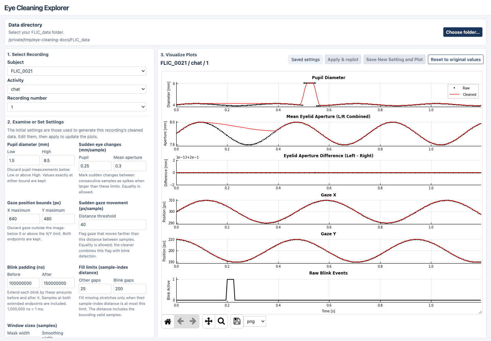
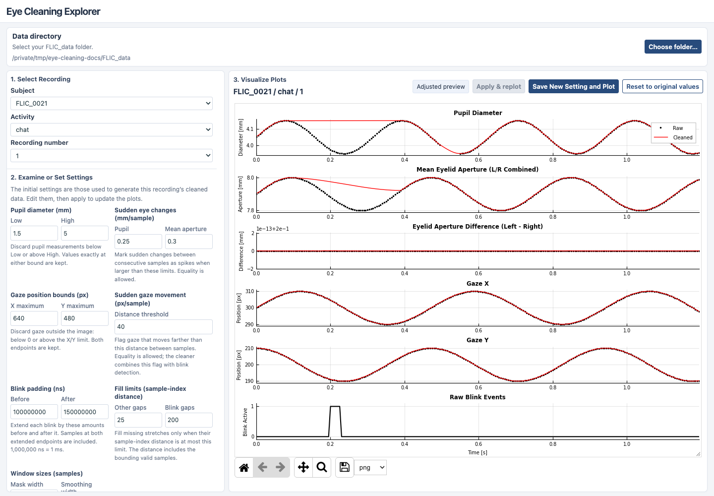

# Eye Cleaning Explorer

Use this page to look through FLIC eye recordings, examine default performance, and try different cleaning
settings. It runs the existing `cleanEyeTracking.py` code and shows its results
in the browser. Editing and applying settings only updates the preview. Use
**Save New Setting and Plot** to update the recording’s metadata and PDF. The
screenshots and demos below use synthetic data, not participant recordings.


## Run the viewer

1. Open a terminal in the `lightLoggerAnalysis` repository folder and activate the Python environment you use for the analysis pipeline. Copy and paste this command, then press **Return**:

   ```sh
   python code/analyzeEyeTracking/webCode/server.py
   ```

2. Leave the terminal running. When it prints `FLIC eye viewer: http://127.0.0.1:8765`, open your browser and paste this into the address bar:

   ```text
   http://127.0.0.1:8765
   ```

3. Click **Choose folder…** and select your data folder as described below.

To stop the viewer, press **Control+C** in the terminal. To restart it, stop it first, run the same command again, and refresh the browser page.

## Select the data folder

Click **Choose folder…** and select the experiment folder directly containing
the subject folders. For example:

```text
scriptedIndoorOutdoor_2026_photophobia/
└── FLIC_0021/
    └── chat/
        └── 1/
            └── eyeData/
```

Select `scriptedIndoorOutdoor_2026_photophobia` in this example, not `FLIC_0021`
or `eyeData`.

Each recording’s `eyeData` directory in Dropbox needs all eight files below.
Make sure they are downloaded to this computer before reviewing it:

| File | Used for |
| --- | --- |
| `3d_eye_states.csv` | Pupil diameter and eyelid measurements. |
| `blinks.csv` | Blink start and end times. |
| `alternative_camera_gaze.csv` | Gaze mapped into world-camera coordinates. |
| `gaze.csv` | The original gaze export. |
| `cleaned_eye_data.csv` | The cleaned eye and gaze data used by later analysis. |
| `egocentric_mapper_metadata.pkl` | The saved settings for mapping gaze into the world camera. |
| `eye_cleaned_vs_raw.pdf` | The saved comparison of raw and cleaned signals. |
| `eye_cleaning_metadata.pkl` | The settings saved when the recording was cleaned. |

The viewer reads the eye-state, blink, alternative-camera gaze, and cleaning
metadata files to calculate a preview. Keep the other files alongside them as
part of the complete recording. The viewer does not need a NAS connection once
the files are local.

## 1. Select Recording

Choose a **Subject**, **Activity**, and **Recording number** in the left panel.
The plot loads automatically. Selecting another recording also loads that
recording's saved cleaning settings; adjustments do not carry over.

## 2. Examine or Set Settings

The initial values come from `eye_cleaning_metadata.pkl`. These are the recording’s
saved cleaning settings. Saving changes in this viewer updates that metadata
and the PDF, but does not regenerate `cleaned_eye_data.csv`.

Edit a value and click **Apply & replot**. Until you apply it, the plot still
shows the previous result. Click **Reset to original values** to discard your
changes and return to the most recently saved values. The three action buttons
are above the plots. Scroll within the left panel to reach the remaining settings.

The label beside the buttons shows where you are:

- **Saved settings:** the plot uses the settings stored in the recording’s metadata.
- **Unapplied changes:** a value has been edited, but the plot still shows the previous result.
- **Adjusted preview:** the changed settings have been applied to the plot but have not been saved.

**Apply & replot** becomes available when you edit a value. **Save New Setting
and Plot** becomes available after you apply a change that differs from the
saved settings. If you edit again, apply those changes before saving.

| Setting | What it controls |
| --- | --- |
| Pupil diameter | Measurements below **Low** or above **High** are rejected. Values exactly at either bound are allowed. |
| Sudden eye changes | How much pupil diameter or mean eyelid aperture can change between consecutive samples before being flagged as a spike. A change must be greater than the threshold; equality is allowed. |
| Gaze position bounds | The largest allowed X and Y coordinates in pixels. Coordinates from zero through the maximum are allowed, including both endpoints. |
| Sudden gaze movement | The distance gaze moves between consecutive samples. Distances greater than this threshold are flagged. The cleaner combines this with blink detection when rejecting gaze. |
| Blink padding | How far to extend each blink before its start and after its end. Units are nanoseconds: 100,000,000 ns is 100 ms. Both extended endpoints are included. |
| Fill limits | How long a missing stretch can be before the cleaner leaves it unfilled. Limits use sample-index distance, not seconds. Interior gaps include the bounding valid samples; edge gaps measure from the edge to the valid sample. A distance equal to the limit is allowed. |
| Mask width | The window used to extend rejected regions to neighboring samples. It must be a positive whole number. |
| Smoothing width | The number of samples in the smoothing window. It must be positive and odd, such as 1, 3, or 5. |

### Example: change a pupil bound

This step-by-step demo changes **Pupil diameter → High** from 8.5 to 5 mm,
applies the change, then restores the saved settings. The example values are
for demonstrating the controls, not recommended cleaning settings.



The tall pupil excursion in the example is rejected after applying the lower
upper bound. The screenshot below shows the recalculated result. The vertical
axis rescales automatically, so check its numbers when comparing views.



## 3. Visualize Plots

The six panels show pupil diameter, mean eyelid aperture, left-minus-right
aperture difference, gaze X, gaze Y, and the original blink events.

Black points are the cleaner's raw reference and red lines are the cleaned
signals. The raw reference has already been aligned and passed through the
cleaner's basic bounds checks; it is not an untouched plot of every CSV row.
The last panel shows the original blink intervals without the added padding.
Time is in seconds from the first gaze sample overlapping the eye-state data.

Use the toolbar below the figure:

- **Home:** restore the original plot limits. This does not restore parameter values.
- **Pan:** click the crossed-arrows button, then drag within a panel.
- **Zoom:** click the magnifying glass, then drag a rectangle around a region.
- **Back / Forward:** move through the toolbar's saved views.
- **Download:** choose a format and click the save icon to download the current figure.

You can also scroll over a plot to zoom its time axis. The time axes are linked,
so all six panels stay aligned. Scroll outside the plot to move through the
page. Browser zoom can make the compact interface larger if needed.

## 4. Save settings and plot

Once the adjusted preview looks right, click **Save New Setting and Plot** above
the plots. This overwrites the supported fields in `eye_cleaning_metadata.pkl` and replaces
`eye_cleaned_vs_raw.pdf` in the selected recording’s `eyeData` folder. Other
metadata fields are preserved. The PDF is regenerated at the cleaner’s default
size and full view, regardless of browser zoom or pan. CSV files are unchanged.
The button shows **Saving…** while the files are written. Wait for the saved
confirmation before continuing; the controls are disabled during saving. After
success, the label returns to **Saved settings** and the save button becomes
gray. **Reset to original values** then uses these newly saved settings, not the
values from before the save. Failed saves show an error and can be retried.

This demo applies the same pupil-bound change and saves it to the synthetic
recording. The confirmation names the two files that were updated.


Saving here does not update `cleaned_eye_data.csv`, `gaze.csv`, or
`egocentric_mapper_metadata.pkl`. If you need cleaned data for later analysis,
rerun the cleaning step with the updated settings. The toolbar’s **Download**
control only downloads a figure; it does not save cleaning settings.
